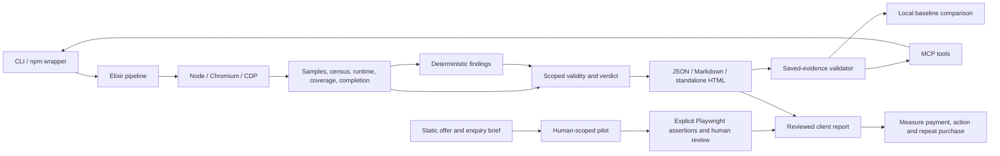

# Product-direction implementation and verification

**Dated record:** The work below records the earlier service-first implementation.
The founder subsequently requested an ambitious product direction and authorized
implementation/testing on Desktop projects without Git commits. Read
[NORTH_STAR.md](NORTH_STAR.md) and the newer
[Desktop implementation/evaluation](DESKTOP_EVALUATION.md) for current priorities,
implemented journey assertions and campaign evidence. Earlier commercial advice
below is historical; it does not establish demand or override the newer direction.

Implemented on **8 October 2026, Asia/Calcutta**, from the approved service-first plan. Source baseline: `feat/census-probe` at `2f6429988a98b7ddc2833f9d312880b6fdd59353`. These are local, uncommitted changes preparing **0.2.0**, not a published release. This document supersedes changed behavior in the original dated [audit](AUDIT.md); it preserves that audit as the before-state.

## What is ready locally

| Deliverable | Implementation |
|---|---|
| Trustworthy scoped verdicts | `VibeGuru.Result` assesses collection, sample completeness, cycle/route scope, runtime observation, census availability and driver completion. JSON, CLI, Markdown and HTML share its verdict. |
| Persisted-report validation | `mcp/report.js` reassesses actual saved evidence and metadata. MCP and the HTML comparison use this same validator; optimistic validity flags cannot substitute for measurements. Legacy reports cannot establish PASS. |
| Four outcomes | PASS / FAIL / INCONCLUSIVE / ERROR map to exits 0 / 1 / 3 / 2. Usage errors remain 64. Medium and lower findings are advisories; known high/critical findings remain FAIL when measurements are partial. |
| Missing and invalid measurements | Failed/unconfirmed GC, null or negative metrics, incomplete cycle samples, missing/zero mutation windows, unavailable constructor counts and failed steps are explicit limits. Invalid collection or a reset document suppresses retention conclusions. |
| Navigation and attribution | Full document reloads invalidate the retained-state chain. History fallback requires a visible configured selector. Console/exception routes describe observation, with delayed-origin uncertainty; request-origin tracking is retained. |
| Durable evidence | Every collected record has a unique ID; findings reference persisted evidence. Memory/census findings retain their consecutive measurement chain. Driver completion and conditions survive serialization. |
| Report-writing failures | Render all artifacts in a unique staging directory. Preserve previous reports when rendering/preflight fails, publish JSON last, and attempt rollback on a copy failure. Errors reach CLI/MCP. Existing reports retain their earlier timestamp; a failed run does not refresh their verdict. This is filesystem staging, not a database transaction or protection from concurrent writers to the same directory. |
| Configuration | Saved route parameters, visible view selectors, custom census targets and whitelisted numeric thresholds propagate to the driver/analyzers. |
| Installation and releases | npm/engine versions align at 0.2.0; root/driver Playwright is pinned to 1.63.0. MIT LICENSE is included. Downloads require HTTPS, a matching SHA-256 manifest, complete streams and verified cache metadata. Escripts launch through Erlang; native assets launch directly. |
| Release gates | Source tests precede cross-builds. All four native runners must pass fresh tarball CLI/browser/MCP checks before release publication. npm publication checks the exact tag, commit, assets and native smoke proof. |
| First UI | Dependency-free [landing page](../../site/index.html) and [fixture report](../../examples/sample-report.html). HTML reports include scope, evidence, trends, reproduction guidance, suggested investigation and local before/after comparison. |
| Commercial kit | [Strategy/investor review](PRODUCT_STRATEGY.md), [intake](../commercial/PILOT_INTAKE.md), [discovery](../commercial/DISCOVERY.md), [delivery template](../commercial/DELIVERY_TEMPLATE.md), [unsent outreach drafts](../commercial/OUTREACH_DRAFTS.md), and [30 researched leads](../commercial/PROSPECTS.md). Lead tiers: 16 strong portfolio matches, 9 conditional, 5 unresolved. They are not customers or evidence of buying intent. |

The landing page offers one React app, up to ten routes, two explicit journeys, six total delivery hours and one confirmation rerun at an experimental $300 price. Its form **downloads a brief; nothing is sent**. No real founder contact channel, payment service or public hosting is configured. No dashboard, accounts, database or hosted execution was added.

## Behavior graph

Investigation and focused heap snapshots remain separate from this normal pipeline. No edge implies their integration or confirmed causal diagnosis.

## Verification evidence

All checks below ran locally on Windows x64 with Node **24.0.0**. Native platform CI has been authored, not executed by this task.

| Check | Result and practical limit |
|---|---|
| Elixir formatting and warning-free compilation | Passed. |
| `mix test` | **175 tests + one doctest, zero failures.** Includes the saved engine report passing the independent Node validator; bad measurements, varying flow marks, missing completion, deadlines, configuration and report failures. |
| `npm test` | **85 tests, zero failures across seven files.** Includes complete persisted evidence, malformed reports, all-route/cycle requirements, census pairing/order, browser export, delayed attribution, installer streams/checksums and real MCP handshake. |
| Fresh browser fixture | Exit 1 / FAIL; 12 findings, 116 unique records, 12/13 known routes visited. `/clean` has no findings; `/protected` is an authentication gap. GC/metrics are retained; unavailable module-scoped `Chart` counts are explicit. |
| Fixture signature verifier | Passed all eight expected defect categories, clean-control checks, ordering, evidence references and attribution qualifications. Exact counts can vary across browser runs. |
| Fresh isolated tarball installation | Passed with the locally built development escript. CLI init, usage 64, real-browser FAIL 1, independent clean flow PASS 0, failed flow INCONCLUSIVE 3, unreachable app ERROR 2, installed MCP verification and filtered full-run verdict were exercised. |
| Standalone HTML / landing browser QA | Widths 320, 390, 768 and 1440: no page overflow or script errors. Valid baseline comparison works; malformed reports are rejected and optimistic missing evidence cannot confirm a fix. Mobile evidence IDs wrap correctly. |
| Landing enquiry | Required/whitespace validation, labelled fields and downloaded text verified. The UI makes no submission claim. |
| Workflow YAML and diff hygiene | Workflow files parse; checked source diff has no whitespace errors. YAML parsing does not establish a passing GitHub Actions run. |
| npm production dependency audit | Zero reported vulnerabilities after compatible dependency refresh; SDK minimum is 1.32.1. This is an advisory-database check, not a security assessment. |
| Publication guard | Correctly blocks this uncommitted, unpublished checkout. No npm publication or GitHub release was attempted. |

Local machine-readable package proof lives in the ignored `reports/package-smoke-win32-x64.json`, including binary hash and `mode: escript`. Public sample evidence is preserved in [sample-report.json](../../examples/sample-report.json). The sample is an actual deliberately broken fixture run with the local workspace prefix redacted, not an external case study.

Reproduce source tests with the README commands. Recreate the public example with `mix run scripts/sample-report.exs <fixture-findings.json>`; the script rejects non-fixture input. See [RELEASING.md](../RELEASING.md) for native and publication steps.

## Still requires external evidence or owner action

1. **Native release validation:** run the reviewed four-platform workflow. Align tested release assets and npm publication before directing prospects to install 0.2.0. Local escript proof does not establish native installer support.
2. **First real case study:** examine suitable external React apps with authorized access. Confirm suspected defects, reproduce after a fix, record rejected findings and setup/debugging effort. Compare equivalent tasks with ordinary Playwright and MemLab when appropriate.
3. **Real enquiry delivery:** choose a founder contact/booking channel and payment arrangement, then publish the reviewed landing page. The local downloadable brief is operational but does not receive leads.
4. **Commercial validation:** research five suitable leads per week, conduct 10–15 qualified conversations, allow at most two free diagnostics, and test paid pilots. No prospect was contacted and no client app was tested during implementation.
5. **Repeat-demand gates:** three pilots with a target of two paid, then at least one repeat engagement and a reusable workflow. Track setup/report/rerun within six hours. Build customer-run CI/baselines after repeat demand; build a dashboard only after at least three paying organizations repeatedly need history/comparisons.

Framework detection is broader than validated navigation. The strongest browser evidence remains React Router fixtures. Authentication capture, external production apps, MemLab comparative work and real-browser investigation conclusions have not been newly validated here. A finding is an investigation lead; an automated clean verdict is scoped and does not establish business outcomes.

## Next task entry point

Read [PROJECT_CONTEXT.md](../../PROJECT_CONTEXT.md), this implementation record and [PRODUCT_STRATEGY.md](PRODUCT_STRATEGY.md), then check current git state. The next practical milestone is a reviewed native release plus an independently confirmed external-app case, followed by one bounded paid pilot. Retain the agreed service scope and record new commercial observations as facts or hypotheses, rather than treating the roadmap as demand evidence.
