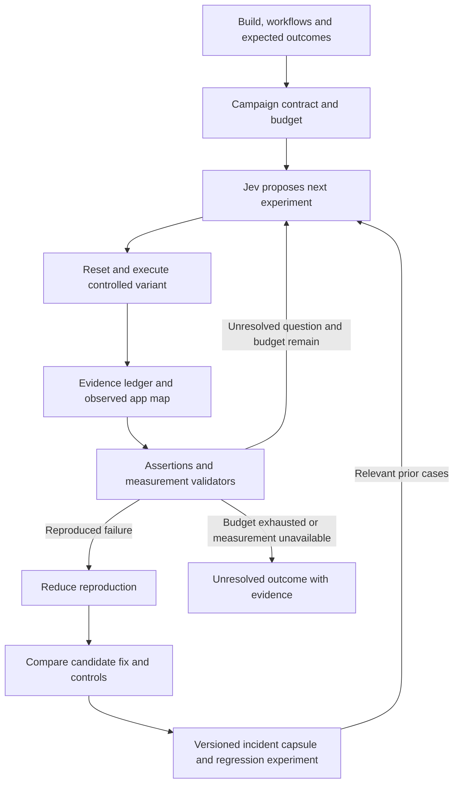

# Vibe Guru: the autonomous reliability lab

Vision review: **9 October 2026, Asia/Calcutta**. The founder explicitly wants an ambitious plan even before using or implementing it. This document defines that longer-term product. [PRODUCT_THESIS.md](PRODUCT_THESIS.md) remains an entry-point experiment; [IMPLEMENTATION.md](IMPLEMENTATION.md) describes current behavior. Planning Jev is appropriate now. Building and selling every proposed capability is a separate decision.

**Implementation update, 9 October:** The first execution layer now exists:
optional flow setup, declared business-outcome assertions, fixed-plan controlled
campaigns, comparisons that preserve remaining/introduced findings, and incident
capsules connecting builds, workflows, observations and findings. Investigation
keeps unsupported hypotheses open. See [DESKTOP_EVALUATION.md](DESKTOP_EVALUATION.md)
and [benchmarks/README.md](../../benchmarks/README.md). Adaptive Jev planning,
automatic minimization, durable incident retrieval and autonomous source repair
remain proposed; the campaign must not be described as those capabilities.

**Implemented follow-up, 9 October:** Structured experiment observations, controlled
overlapping-response schedules and real WebSocket reconnect/convergence checks now
extend that execution layer. A gateway race was reproduced on an unchanged copy;
a manually authored patch in a second disposable copy passed the failing condition
and the ordered control. This is a bounded source-candidate comparison, not
autonomous repair. See [NETWORK_EVALUATION.md](NETWORK_EVALUATION.md).

**Adversarial lab follow-up, 9 October:** Two new isolated fixture apps now exercise
pending navigation, real HTTP recovery and duplicate-write integrity. A repeatable
twenty-case matrix and separate evidence-corruption corpus strengthen execution
and report validity. These are supplied fixed-plan experiments and authored
candidate modes, not adaptive discovery. See [ADVERSARIAL_EVALUATION.md](ADVERSARIAL_EVALUATION.md).

## The product we could build

**State-resilience follow-up, 10 October:** Storage recovery and two-client lost
update experiments extend the fixed-plan lab to thirty-six cases. Cold-start
controls, versioned server history, explicit reconciliation and stricter cycle
completion evidence are implemented. The dashboard separates target assertions
from whole-app verdicts. See [STATE_RESILIENCE.md](STATE_RESILIENCE.md). These
remain authored scenarios; adaptive planning and autonomous repair remain proposed.

**An autonomous reliability lab that explores a web app under varied conditions, investigates failures, produces short reproductions, checks proposed fixes and retains useful experiments for future releases.**

The customer starts with a build, relevant workflows and expected behavior, or a concrete symptom. A campaign runs within an execution budget. It returns reproduced failures, evidence supporting and challenging explanations, a reusable failing test, and the boundaries of any fix verification. Exploratory coverage and unresolved cases remain visible.

Example customer request: "Before we release, investigate whether our reporting workflow loses state, keeps background work alive, or fails when responses are slow. Preserve any reproduction and check our proposed patch."

This is a larger vision than a static scan or memory report. The prior runtime regression thesis supplies one useful entry point into it. The product combines AI planning with experiment infrastructure; it is not predicated on AI being unable to write tests or debugging scripts.

## A concrete proposed investigation

Hypothetical reporting app: changing filters rapidly sometimes shows data for an older selection. A long session also slows down.

1. Import an agreed journey and assertions: the latest selection controls the displayed results; leaving the screen stops its view-specific work.
2. Observe normal execution. Record inputs, request ordering, runtime events and applicable resource measurements.
3. Jev maintains separate explanations: stale response overwrites state, duplicated subscription, retained widget, or legitimate cache growth. These are hypotheses, not detector findings.
4. Run discriminating experiments: deliberately delay one response, vary navigation timing, repeat the journey, and isolate the suspected background activity in a controlled variant where available.
5. Keep both normal and failing cases. Reduce a longer failing journey to a short sequence while preserving the same asserted failure.
6. Hand the reproduction and evidence to the developer or their coding agent. Test the proposed patch under the failing condition and relevant neighboring controls.
7. Save a versioned incident capsule and regression experiment. Future builds can rerun it, or flag that its assumptions no longer apply.

The hypothetical result might be: "The earlier request completes last and overwrites the newer selection under the recorded delay schedule. The candidate fixes this assertion, but background requests still persist after navigation." Do not group two independent defects into one cause merely because they occur on the same route.

## The capability map

| Capability | Customer outcome | Proposed implementation role |
|---|---|---|
| App and workflow map | Know which paths and expected outcomes a campaign covers | Import tests, routes, source references and observed requests; keep inferred links distinct from observations |
| Scenario exploration | Discover conditions beyond one happy-path script | Vary valid action sequences, delays, responses, data shapes and repeated use within the declared contract |
| Adaptive investigation | Spend effort on experiments that distinguish explanations | Jev selects a supported action and predicts what different outcomes would mean |
| Controlled execution | Compare outcomes with fewer unexplained environmental differences | Resettable browser/data fixtures, pinned build identity, named interventions and normal controls |
| Measurement adapters | Capture evidence across relevant layers | Existing browser probes plus proven Playwright/DevTools/MemLab tools; API/server adapters later |
| Reproduction reduction | Give a developer a short actionable failure case | Minimize actions/inputs/interventions while rerunning the same failure assertion |
| Fix verification | Reject a patch that hides symptoms or removes required functionality | Failing case, functional controls and nearby scenarios on comparable builds |
| Incident memory | Reuse hard-earned debugging work | Versioned reproductions, evidence, assumptions, rejected hypotheses, patch results and invalidation rules |
| Investigation workspace | Let a team inspect and steer experiments | A proposed UI with experiment tree, timelines, reproduction playback and evidence links |

A useful future UI would show what was tried and why, which condition triggered the failure, and what still fails after a patch. That is a product workspace to plan, distinct from the existing static landing page.

## Architecture and Jev's job

Jev is the experiment planner. It can propose explanations, select a probe or perturbation, identify a useful control and choose a next question. The executor owns supported actions, reset semantics and the budget. Assertions and validators decide whether the measured outcome satisfies a declared check. Hypothesis interpretation may involve reasoning, but model prose never upgrades a measurement into a confirmed fact.

A proposed decision records: hypothesis IDs, chosen experiment ID, input/build identity, intervention, control, observable prediction, required checks and cost limit. Unsupported actions are rejected. A missing metric preserves uncertainty. A conclusion must reference actual experiments and supporting/contradicting evidence.

Use recorded decisions for replay of a campaign plan; that does not make physical browser execution deterministic. A pinned model also does not guarantee identical decisions. Replayable input, a reproducible failure and bit-for-bit execution are different capabilities.

## An evidence graph with a purpose

Proposed nodes: builds, workflows, conditions, experiments, measurements, assertions, hypotheses, reproductions and candidate fixes. Proposed edges distinguish:

- `observed_during`: an event or value appeared in an experiment.
- `correlated_with`: events moved together; causation is not established.
- `tested_by`: an experiment was designed to distinguish a hypothesis.
- `supports` / `contradicts`: results bear on a specific explanation under recorded assumptions.
- `reproduced_by`: a saved experiment produces the asserted failure at a recorded repeat rate.
- `improved_by` / `still_fails_after`: candidate comparison results for a specific check.
- `invalidated_by`: a later workflow/build change makes prior assumptions inapplicable.

This graph is an investigation record, not a graph database requirement or an automatically correct causal model. Initial storage can be versioned JSON and artifacts. The existing repository context graph inventories source relationships; it is not this proposed runtime experiment graph.

## Test vectors worth planning

| Family | Conditions to explore | Required truth source |
|---|---|---|
| Lifecycle and resource behavior | Repeated mount/unmount, navigation, retained listeners/widgets, work continuing after exit | Valid resource evidence plus explicit ownership expectations |
| Asynchronous behavior | Slow or out-of-order responses, rapid filter changes, navigation during pending work | Asserted latest-state behavior and recorded ordering |
| Recovery | Timeouts, failed requests, offline/reconnect and retries | Agreed recovery behavior; a deliberately injected fault is not itself an app defect |
| State integrity | Duplicate actions, interrupted saves, reloads and multiple sessions | Test data and explicit invariants, preferably observable backend outcomes where relevant |
| Responsiveness | Heavy data, repeated operations, long tasks and growing action latency | Comparable hosts/workloads and calibrated measurements; separate forced-GC capture |
| API/backend and access rules | Contract changes, endpoint failures and role-specific actions | Additional adapters, authorized isolated environments and supplied assertions |

Business rules cannot be inferred conclusively from implementation alone. A system that guesses every expected result can congratulate its own mistakes. Start from user-reviewed properties and generic runtime checks, then expand.

## What is actually present

- Browser memory/runtime/census instrumentation, deterministic analysis, CLI/MCP and reporting are present.
- `Investigation.State`, the policy callback, rules loop, budget handling and probe catalog exist separately from the normal pipeline.
- The focused heap snapshot summarizes constructors and shallow bytes. It does not implement complete retaining paths or universal source-line causality.
- `Policy.Jev`, adaptive scenario generation, experiment controls, reproduction minimization, incident memory and the investigation workspace are not implemented.
- Current hypothesis elimination/grouping has documented evidence gaps. It is groundwork to revise, not demonstrated causal diagnosis.

The old investigation architecture includes draft examples and illustrative confidence/token claims. These are not validation of this vision or measurements of a working Jev product.

## Existing products and the opportunity to test

Primary sources checked **9 October 2026**:

- [Antithesis](https://antithesis.com/docs/introduction/how_antithesis_works/) explores stateful systems with faults and assertions in a deterministic environment. This is a useful analogue for serious execution infrastructure, not something the current Chromium driver provides.
- [Meticulous](https://meticulous.ai/how-it-works) supplies frontend replay-based testing and describes browser-level determinism. Generic automatic regression testing is already a competitive category.
- [Replay MCP](https://docs.replay.io/basics/replay-mcp/overview) gives coding agents recording-based runtime/source/React/network inspection. Time-travel debugging alone is not a unique proposed capability.
- [Sentry Issue Fix](https://docs.sentry.io/api/seer/start-seer-issue-fix/) covers root-cause investigation, proposed solutions and code changes. "AI finds and fixes bugs" is also insufficient differentiation.
- [Playwright network tooling](https://playwright.dev/docs/network) supplies interception, response modification and WebSocket tools that could support early experiments. Reuse these rather than inventing every actuator.

The opportunity to test is an accessible, budgeted experiment-to-reproduction-to-fix workflow for ordinary web apps, with useful repeated-use and asynchronous failure evidence. No unique category or moat is claimed.

AI agents can assemble this too. Reasons to buy would have to come from lower setup/maintenance effort, dependable environments and integrations, useful scenario search, reproducible findings and reusable history. A calibrated evaluation corpus and confirmed failure cases could compound expertise. A graph, model or agent count alone does not establish defensibility. Customer data remains private by default; cross-customer learning requires an agreed basis and cannot be assumed.

## Who would pay and what they would buy

Proposed first purchasers: engineering leads at web product teams maintaining important stateful workflows; agency technical leads maintaining multiple client apps; later, app-builder/agent-platform teams integrating a verifier.

The paid outcome is a **reliability investigation campaign**: explore agreed workflows/conditions within a budget and deliver reproduced failures, useful evidence and fix checks. Recurring campaigns, private runners and maintained regression experiments could support team pricing. A platform SDK could support execution-volume contracts later. These are packaging hypotheses, not validated demand or a published price.

The broad audience is web application teams dealing with state, asynchronous work and repeated use. The first design partner should have one valuable workflow and be willing to define correct behavior. Brochure sites and unlimited "verify everything" requests are poor matches for this proposed product.

## Plan big; validate the important leap

1. **Design now:** document campaign/experiment/incident contracts, Jev's supported actions, expected UI and capability stages. Do not build another general agent framework or replace the existing engine solely for this plan.
2. **First experimental demonstration:** create a controlled case with two independent defects on one route, such as a retained widget and an unbounded cache. Compare interventions; reject the claim that fixing one proves the whole route healthy. Reject a purported fix that removes the required widget or skips the workflow. Save the experiment and rerun it on a new build. Label injected defects explicitly.
3. **Second failure family:** a supplied workflow with out-of-order responses and a latest-selection assertion. Explore delays/action ordering and reduce a reproduced failure. This checks whether the architecture generalizes beyond memory.
4. **External evaluation:** compare useful findings, reproduction reliability, setup effort and total execution cost against a capable coding agent with the same tool access and budget. Separate evaluation from any cases used to tune Jev/rules. Stop conditions and unresolved outcomes count as results.
5. **Product expansion:** if teams reuse and pay for campaigns, add the investigation workspace, durable campaign execution and the most valuable next adapter. Hosted fleets, backend-wide exploration, production recording and stronger determinism remain later commitments.

The first demonstration must establish the experiment and fix-validation loop, not just show a model narrating telemetry. If a generic agent provides equivalent results with less effort, integrate with it or revise the claimed value. If controlled execution is too costly or every app needs bespoke intervention, the proposed scalable product remains unproven.

This document defines the longer-term architecture. The dated implementation
updates above identify the execution capabilities that now exist. Jev, a general
simulator, an investigation UI and automatic source-repair workflows remain plans.
