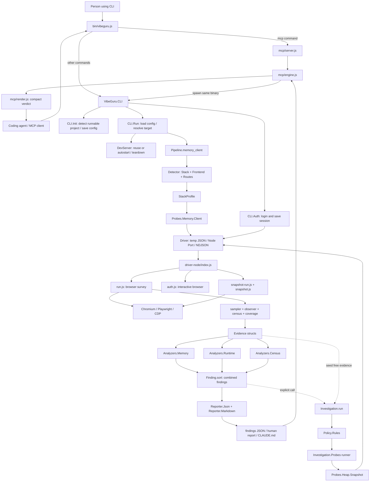
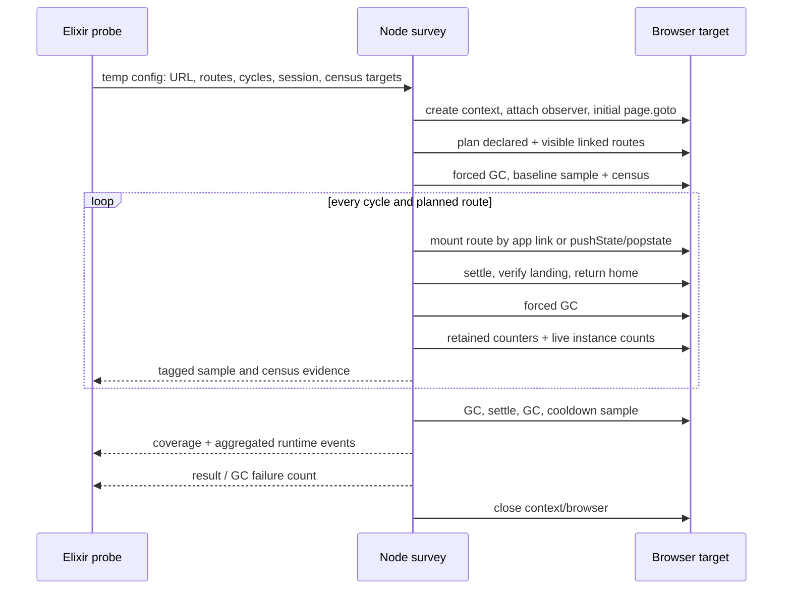
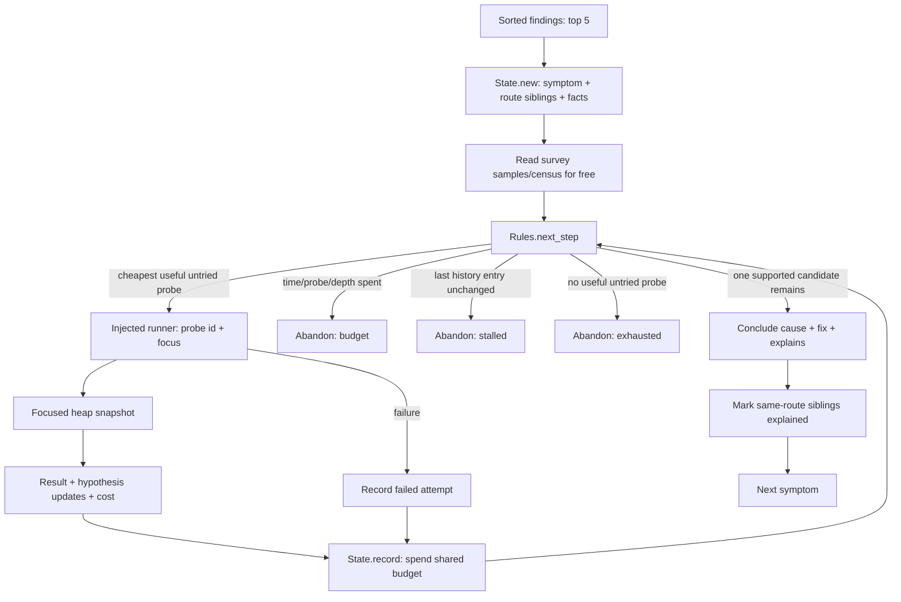
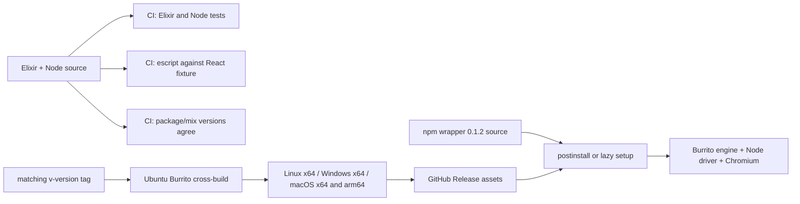

# Vibe Guru: repository understanding

Audited **8 October 2026**, local workspace `C:\Users\Shashank\vibecheck`.
Source baseline: `feat/census-probe` at `2f6429988a98b7ddc2833f9d312880b6fdd59353`.

**Implementation addendum, 8 October 2026:** this narrative preserves the original inspected baseline. Read [IMPLEMENTATION.md](IMPLEMENTATION.md) first for changed behavior: local 0.2.0, schema 2, scoped validity/verdicts, complete evidence, staged reporting, static offer/report UI and release gates. [PRODUCT_STRATEGY.md](PRODUCT_STRATEGY.md) records the approved service-first direction. The generated graph/index now cover those new source files as well.

This is a reusable engineering context snapshot, based on repository source, manifests, test contracts, CI definitions, historical documentation, and local checks. It distinguishes observed implementation from design intent. See [AUDIT.md](AUDIT.md) for verification and gaps, and [FILE_INDEX.md](FILE_INDEX.md) for individual files.

## 1. What the project is

Vibe Guru is a **local runtime verification tool for web apps**, designed to give coding agents compact, actionable findings about behavior they cannot establish by reading source alone. Its tagline is “Your AI wrote the code. Vibe Guru tells it what it forgot.”

A user points it at an app directory or an already-running URL. It detects the framework and routes, starts the development server if needed, drives the app in Chromium, collects measurements, applies deterministic signatures, and writes reports. An MCP client can invoke the same engine and get a compact verdict instead of raw browser interactions.

The central product distinction is the output: a measured defect, its route/source clue, severity, confidence, numbers, and suggested cleanup/fix, ready for a coding agent. The tool produces advice; it does not edit the target app or automatically prove that its suggested cause is correct.

The older handover describes a possible open-core business: local OSS runner, later hosted history, scheduled runs, dashboards, and fix PRs. That is **historical product intent**, not an implemented hosted service or a newly agreed roadmap.

## 2. Scope: implemented, separate, planned

| Capability | Actual state in this checkout |
|---|---|
| `memory.client` survey | Implemented, invoked by CLI/MCP |
| `runtime.client` checks | Implemented analyzer + passive observer in the same survey |
| `census.client` retained instances | Implemented in the survey; findings use this vector name |
| Static route extraction + coverage | Implemented with parser/router limitations |
| Manual login/session reuse | Implemented `auth` command; captures browser storage state |
| Recorded interaction flow | Implemented CLI option and driver flow loader |
| Investigation state/rules/loop | Implemented modules and synthetic tests; separate from Pipeline |
| Focused `heap.snapshot` | Implemented Node probe and Elixir interpreter; callable through explicit investigation runner |
| Source-map attribution for memory | Planned; `source_maps` is only detection metadata |
| Allocation sampling, focused listener census | Catalog entries marked unavailable |
| Jev/model policy | Described in docs; no implementation |
| Server memory, database, Docker, code quality, load balancing, security vectors | No implementation found |
| Hosted dashboard/history, automated fixes/PRs | No implementation found |

It is not a general correctness proof, static code review engine, backend load tester, Lighthouse score tool, production monitoring service, or an LLM analyzer. The framework support implied by detection is broader than the framework behavior established by the bundled React fixture.

## 3. Folder ownership map

| Path | Role | Treatment |
|---|---|---|
| `lib/vibe_guru/` | Elixir detector, contracts, analyzers, pipeline, CLI, process management | Product source |
| `lib/vibe_guru/investigation*` | Adaptive investigation loop and deterministic policy | Separate implemented subsystem |
| `driver-node/` | ESM Node measurement driver, Playwright/CDP | Product source; private package |
| `mcp/` | CommonJS server, binary runner, agent-facing renderer | Product source |
| `bin/`, `scripts/lib/`, `scripts/postinstall.js` | npm launcher, binary fetch, Chromium setup | Distribution source |
| `scripts/test-node.mjs`, `scripts/verify-fixtures.mjs` | Test discovery and shared integration assertions | Verification tooling |
| `test/` | ExUnit tests using synthetic evidence and policy/probe results | Engine tests |
| `test-node/` | `node:test` suites, fake browser/CDP, MCP handshake, renderer fixture | Node tests |
| `test-app/` | Vite/React SPA with intentional defects and a clean control | Test fixture; defects are intentional |
| `.github/workflows/`, `Jenkinsfile` | Test gates and release cross-build/integration example | CI definitions |
| `docs/`, `README.md` | Architecture and usage explanations | Documentation; may lag implementation |
| `mix.exs`, `mix.lock` | Elixir app/release/dependency manifest | Source of engine version/build contract |
| `package.json`, `package-lock.json` | Published npm wrapper/MCP package | Source of npm version/dependency contract |
| `deps/`, `_build/`, `node_modules/` | Downloaded dependencies and build output | Local generated/vendor content |
| `vibeguru` | Generated local escript, requiring Erlang | Ignored build artifact |
| `reports/` | Generated analysis reports, including this audit's browser run | Ignored evidence; not source |
| `tmp_out_rename/` | Older generated reports | Ignored historical output |
| `HANDOVER.md` | Older accumulated session notes | Present but ignored by `handover.md` rule on this Windows checkout |

There were **113 tracked files** at the start of this task. Dependency directories were treated as vendor content: inspected via manifests/installed version metadata, not audited file-by-file. Generated reports were read as dated evidence, not instructions. No `AGENTS.md` was found in the repository or checked ancestor locations.

## 4. End-to-end architecture graph

Solid paths below are the standard product run. Dashed paths show a separately invoked capability.



The pipeline name and report envelope still say `memory.client`, although the findings list can contain all three survey vectors. Runtime and census are additional analyzers on the same expensive browser run.

## 5. Entry points and lifecycle

### npm and MCP

`package.json` installs `bin/vibeguru.js` as `vibeguru`. The wrapper intercepts `mcp` before binary resolution. MCP owns stdout for JSON-RPC, and logs go to stderr. For other commands, the wrapper selects a cached/downloaded platform binary, sets `VIBEGURU_DRIVER_PATH`, inherits stdio, and mirrors process status.

`mcp/server.js` exposes exactly **two tools**:

| Tool | Behavior |
|---|---|
| `verify_runtime` | Accepts root, optional URL, cycles, routes, `write_report`; starts/configures/runs engine; caches the report in server memory |
| `read_findings` | Reuses the cached report or reads a report from the supplied root; filters by minimum severity and exact primary route |

Defaults are 4 cycles and 12 routes. Schemas constrain cycles to 1–40 and routes to 1–50. `mcp/engine.js` treats binary exit 0 or 1 as a completed analysis, and reads the JSON report. Explicit URL uses `memory:client`; otherwise it calls `init` when config is missing and then `run`. Report output defaults to a temp directory; `write_report` chooses the project root. Automatic `init` can still create `vibeguru.json` in that root.

Rendering limits are 30 displayed findings, 240 summary characters, and 260 fix characters per finding. No findings plus low coverage gives `INCONCLUSIVE`; findings of any severity give MCP `FAIL`. The standard CLI only exits 1 for high/critical findings. Low coverage by itself does not change CLI exit status.

### Elixir CLI

`VibeGuru.CLI.main/1` dispatches `init`, `run`, `auth`, `memory:client`, then calls `System.halt` once. The `mcp` command belongs to the Node wrapper, not the escript.

`init` uses `Project.detect` to choose the first of `dev`, `start`, `develop`, `serve`, forms `npm run <script>`, detects a port, and saves `vibeguru.json`. Default framework ports are Vite 5173, Next/CRA 3000, webpack 8080, fallback 3000.

`run` loads config, checks target TCP reachability across IPv4/IPv6, reuses a listener or starts `dev_command` in the app root, calls Pipeline, prints a summary, and stops only the server it started in a `try/after`. TCP readiness does not validate the identity/health of the HTTP app. Captured server output goes to a temp log. Windows teardown uses `taskkill /T`; Unix uses `pkill -P` and `kill`.

`auth` opens headed Chromium for a person to sign in. The driver snapshots cookies/localStorage every two seconds and on navigation; it saves the latest state when the browser closes/times out. Elixir writes `.vibeguru/auth.json` and a self-ignore file. Standard runs automatically pass an existing session path. The implementation captures storage state, not login form credentials; session contents can still be sensitive.

| Exit | Meaning |
|---:|---|
| 0 | Completed analysis without high/critical findings, or successful init/auth |
| 1 | Completed analysis with high/critical findings |
| 2 | Run/config/driver/server error |
| 64 | Unsupported command / usage |

### Driver/process boundary

`Driver.run` resolves Node and the driver, writes config to a temporary JSON file, launches Node via an Erlang Port, buffers NDJSON lines, collects `evidence`/`marker`, forwards `log`, and stores `result`/`error`. The config file is removed in `after`. Driver selection is explicit option → application config → `VIBEGURU_DRIVER_PATH` → compile-time local fallback. Directory overrides resolve to `index.js`.

`driver-node/index.js` supports config file, stdin JSON, or positional URL. Modes are `auto`, `flow`, `auth`, `snapshot`; auth/snapshot dispatch separately, other modes use the survey runner. Only explicitly listed config fields survive `withDefaults`, so new fields must cross both sides of this boundary.

## 6. Browser measurement graph and invariants



Load-bearing rules:

1. **Route cycling must preserve the document/heap.** A full reload erases accumulated leaks. Initial page load is allowed; cycling uses app links or history. Real link/router behavior still needs verification for each supported framework.
2. **Force GC before retained measurements.** Transient framework garbage is not evidence of a leak. `collectGarbage` tries HeapProfiler, then a forced memory purge, and returns a success boolean.
3. **Sample after mount/unmount, at the home state.** Consecutive measurements attribute increments to the route just exercised.
4. **Missing numbers remain null.** In particular a census null means an inaccessible/unmeasured prototype, while zero is a measurement.
5. **Release CDP handles.** Census handles can pin the very objects being counted if retained.
6. **Keep facts and interpretations separate.** Browser driver collects; analyzers apply signatures; reporters render.
7. **Sort combined findings once.** Concatenating individually sorted analyzer results does not preserve global severity ordering.
8. **Keep stdout protocol-clean.** Driver uses NDJSON and MCP uses JSON-RPC; diagnostic text belongs on stderr or log events.

`sampler.js` reads DOM node/document/listener counts through CDP, heap metrics from `performance.memory`, and attached canvas/WebGL counts through page evaluation. Canvas metrics are coarse; no precise canvas/WebGL signature is currently emitted.

`observer.js` attaches before the first load, records page exceptions, console errors, transport failures, HTTP ≥400, and DOM mutation counts. It normalizes messages and counts occurrences; it tracks request-origin routes so delayed network failure is attributed back to the request issuer. It filters known dev-tool noise and aborts. Event deduplication can combine several routes into one finding with a primary route and additional metrics.

Auto-crawl merges source-declared routes with visible same-origin anchors from the landing page. Declared routes lead; duplicates collapse; dynamic values come from configuration; route-limit omissions are recorded. A route is recorded reachable/unreachable on cycle 1, based mainly on the landed pathname. It is not recursive interactive exploration of every state in an app.

Flow files are ESM modules exporting `default` or `flow(page, {cycle, mark})`. `mark(label)` takes a GC-backed sample under that label; otherwise a cycle receives the label `flow`. A flow is responsible for meaningful mount/unmount navigation. This mode has weaker coverage/runtime/census integration than auto mode; see the audit.

## 7. Data contracts

| Model | Fields / meaning |
|---|---|
| `StackProfile` | root, URL, surface, stack, bundler, router, chart libraries, source-map heuristic, declared routes, metadata |
| `Evidence` | id, probe_id, kind, phase, cycle, timestamp, context, data; raw measurements |
| `Finding` | id, vector, signature, severity, confidence, title, summary, evidence_refs, metrics, location, fix, ai_prompt |
| `Coverage` | declared/discovered counts, visited paths, unreachable paths/reasons, known count, ratio, low flag |
| Investigation `State` | symptom, same-route siblings, facts, hypotheses, history, probe offers, remaining budget |

Probe, Analyzer, and Reporter are Elixir behaviours. Detector is a concrete module, despite older prose claiming four behaviour layers. The heap investigation probe uses its own `investigate/3` result contract rather than implementing the survey `Probe` behaviour.

Survey NDJSON event vocabulary: `evidence`, `marker`, `log`, `result`, `error`. Survey evidence kinds include sample, config marker, census, runtime_event, coverage. String-to-atom mapping is whitelisted. Snapshot mode emits `heap_census`, interpreted directly by the focused heap probe rather than the survey mapper.

JSON reports contain `tool`, `schema_version: 1`, envelope `vector`, generation time, profile, severity summary, coverage, evidence_count, findings. They contain **an evidence count, not the raw evidence stream**. Raw evidence is returned in memory by Pipeline; reusable on-disk evidence caching is not implemented.

Outputs are `vibeguru-findings.json`, `vibeguru-report.md`, and `CLAUDE.md`. CLI defaults to the target root; choose a separate `--out` for fixture/verification work. Report writes replace those files. This project-context pack deliberately uses other filenames.

## 8. Analyzer logic and defaults

Memory and census use consecutive deltas over the baseline/cycle chain, group by route (and class for census), average increments, and require consistent positive growth. When there are at least three cycles, they discard cycle 1 as warm-up. Memory recovery is `(peak - cooldown)/(peak - baseline)`, bounded to 0–1.

| Analyzer | Signature | Severity / trigger |
|---|---|---|
| Memory | `detached_dom_leak` | high; nodes ≥100 per visit, positive fraction ≥0.6 |
| Memory | `listener_leak` | high; listeners ≥2 per visit, positive fraction ≥0.6 |
| Memory | `route_heap_growth` | high; heap ≥150,000 bytes per visit, positive fraction ≥0.6; suppressed on detached-node routes |
| Memory | `initial_bundle_heap` | medium; baseline heap ≥80,000,000 bytes |
| Memory | `slow_recovery` | low; partial recovery >0.3 and <0.8 with positive growth; additional suppression rules |
| Runtime | `uncaught_exception` | critical; page_error |
| Runtime | `render_loop` | critical; mean mutations ≥400/sec and ≥0.6 of post-warm-up windows hot |
| Runtime | `failed_request` | high; transport failure or HTTP ≥500 |
| Runtime | `console_error` | high; recorded console.error after noise/echo filtering |
| Runtime | `http_error` | medium; other HTTP error status |
| Census | `retained_instances` | high; class instances ≥1 per visit, positive fraction ≥0.6 |

Confidence is a heuristic label (`high`, `medium`, `low`), not a calibrated probability. Mutation rate is an indirect render-loop signal. Node counters imply retained nodes; they do not establish an exact detached-subtree retaining path. Suggested library cleanup comes from detected dependencies/templates.

Runtime drops narrow console echoes of a measured render loop or network failure on the same route. Memory suppresses heap growth already explained by a node finding. Separate listener/census findings remain distinct in the standard report; cause consolidation requires investigation.

Census targets are user extras, then detected library classes, then universal resources, deduplicated and capped at 12. Universals: MutationObserver, ResizeObserver, IntersectionObserver, PerformanceObserver, WebSocket, EventSource, Worker. Library mapping includes Chart.js → Chart, Three → WebGLRenderer/Scene/Texture, ECharts → ECharts. CDP `Runtime.queryObjects` requires a globally accessible prototype; module-scoped imported classes often report null. Heap snapshots are the separate mechanism for those objects.

## 9. Investigation graph: separate subsystem



The default run budget is 120,000 ms, 8 probes, maximum depth 3, at most 5 symptoms. The implementation shares the budget including depth across symptoms. Probe cost ordering is cheap → medium → expensive, then typical duration, then id. `run_probe` is injected; without it the loop uses existing evidence and records failures if another probe is requested.

The catalog advertises census (survey-only) and heap.snapshot (focused runner); allocation.sample and listener.census are planned. Detector facts can provide a Chart/WebGLRenderer/ECharts hint.

Focused snapshots launch a fresh browser/session, warm the chosen route once, capture baseline, visit the route three times by default, force GC twice, and capture final heap. The parser reads V8 field metadata rather than fixed column positions, counts object constructors and shallow self-size, excludes generic noise, retains targeted constructors plus top 40 others, and computes positive count growth per visit. Capture has a 400 MiB chunk-length guard.

This is **constructor-count growth**, not retaining-path analysis, allocation-stack/source-map analysis, or exact component-line attribution. Interpretation supports/eliminates `retained_library_object` and `unbounded_cache`; Maps/Sets growing alongside a confirmed hinted object are heuristically treated as its internals. `Rules` currently claims all same-route siblings in `explains`. Integration and causality gaps are detailed in the audit.

## 10. Detection and supported surfaces

Stack detection merges package dependencies/devDependencies, prioritizing Next, React, Vue, Svelte, and detects Next/Vite/CRA/webpack bundlers. Frontend detection finds common router packages and chart/graphics libraries. Vite/Next implies source maps `present` heuristically; maps are not fetched/decoded.

Route extraction directly supports Next app/pages trees, SvelteKit `+page.svelte`, Nuxt pages through the explicit `:nuxt` extractor, and literal React/Vue Router paths in files that import a router. It strips route groups, filters framework special/API files, deduplicates, and sorts.

Important boundaries: Nuxt is not selected by Frontend.router_from; declarative extraction uses regex, not a JS AST; constants/nested route semantics and some wildcard/optional dynamic forms are incomplete. A filesystem route list is not proof that history fallback works for that framework. Coverage is over known routes, not all features, auth roles, query states, or parameter values.

## 11. Configuration and development environment

| Layer | Defaults |
|---|---|
| `Config` / normal CLI | 12 cycles, 400 ms settle, 8 routes |
| Direct CLI `memory:client` | also starts from Config defaults: 12 / 400 / 8 |
| Direct Pipeline and Node driver | 20 cycles, 500 ms settle, 8 routes |
| MCP | 4 cycles, 12 routes; Config settle value when config-driven |
| Focused snapshot | 3 visits, 500 ms settle, 180,000 ms driver receive timeout |
| Normal driver | 600,000 ms receive timeout |
| CLI dev-server startup | 90,000 ms unless overridden |

The supported saved config fields are `url`, `dev_command`, `port`, `cycles`, `settle_ms`, `routes_limit`, `flow`. Do not assume README examples for `routeParams` or thresholds are actually loaded: see audit. CLI accepts root/out/cycles/settle/routes/flow/headless/quiet/timeout switches; init/auth have their own smaller switch lists.

Local tools verified during this audit: Windows PowerShell, Node **24.0.0**, npm **11.3.0**, Elixir **1.18.4**, Erlang/OTP **27**. Mix/elixir/escript resolve on current PATH. Historical handover PATH warnings do not describe this session, but these are the fallback locations if needed:

```powershell
$env:Path = "C:\Program Files\Erlang OTP\bin;$env:LOCALAPPDATA\Elixir\bin;" + $env:Path
```

Useful commands from the repo root:

```powershell
mix format --check-formatted
mix compile --warnings-as-errors
mix test
npm test
mix escript.build
escript vibeguru run --root test-app --out reports/check --cycles 4 --routes 14 --quiet
node scripts/verify-fixtures.mjs reports/check/vibeguru-findings.json
python scripts/context-map.py
```

The fixture run is expected to exit 1 because it detects intentional high/critical defects. Raise the route cap to reach the complete fixture set. Do not run `init` on the fixture unnecessarily; it rewrites its tracked config.

Install manifests if absent using the lockfiles; skip root postinstall for source-only work (`npm ci --ignore-scripts`) to avoid fetching a release binary. Browser installation is separate. Local escripts on Windows run through `escript vibeguru`; the MCP `VIBEGURU_BINARY` override expects a directly spawnable binary and does not automatically adapt an escript.

Pinned lockfile facts: root Playwright **1.63.0**, driver Playwright **1.60.0**, MCP SDK **1.30.0**, Zod **4.6.1**; fixture React **18.3.1**, Vite **5.4.21**, Chart.js **4.5.1**. Driver resolves its nested Playwright in this development tree; published packaging relies on root Playwright. This differs across local/packaged execution.

## 12. Distribution and CI graph



Root npm and Mix versions both equal **0.1.2**. Driver/fixture packages are private and independently labeled 0.1.0. Release build bundles ERTS/BEAM through Burrito; local escript does not. Release startup uses Application → CLI.boot → `Burrito.Util.Args.get_arguments()` to work around the documented Windows argv issue. The OTP supervision tree is empty; this is a CLI app, not a supervised service runtime.

`.github/workflows/ci.yml` has Elixir, Node (20 and 22 matrix), version agreement, and real browser e2e jobs; it runs on PRs, main pushes, or manual dispatch. E2E builds/runs the escript and uses the shared fixture verifier. Release workflow uses Ubuntu 24.04, Elixir 1.18.5, OTP 27.3.4.16, Zig 0.15.2, xz, and 7z, checks prebuilt ERTS availability, cross-builds four targets, and stages canonical asset names. Manual dispatch uploads artifacts; tag pushes additionally publish GitHub assets. It does not run `npm publish`.

Asset names are coupled between release.yml and `scripts/lib/platform.js`. Wrapper downloads use `releases/download/v<package version>/<asset>`. Cached binaries live under package `vendor/`. Postinstall setup is best-effort; launcher retries downloads lazily. The current remote release/npm publication and CI status were **not verified online** in this folder audit.

`Jenkinsfile` runs engine checks plus fixture verification and provides a user integration example. Its shell steps assume Unix despite `agent any`. It is a definition, not evidence that a Jenkins instance has executed it.

## 13. Tests and fixture intent

| Fixture route | Purpose |
|---|---|
| `/` | Landing/nav and clean starting surface |
| `/clean` | Listener and timer properly removed; must stay finding-free |
| `/detached` | Module-held detached DOM batches; node retention |
| `/listeners` | Two window listeners per mount, no cleanup |
| `/grow` | Module-held array batches; heap retention |
| `/charts` | Chart.js instance never destroyed; heap/listener/observer retention |
| `/crash` | Delayed uncaught TypeError so the SPA remains navigable |
| `/render-loop` | Effect updates its own state without dependencies |
| `/log-error` | Explicit swallowed console.error |
| `/bad-fetch` | Dead local backend and missing endpoint |
| `/observers` | Module-held ResizeObserver and unclosed WebSocket |
| `/login` | Fake sign-in writes localStorage flag |
| `/protected` | Not linked in nav; redirects without session; leaks listeners when authenticated |

The fixture intentionally omits React.StrictMode for stable per-mount counts. Do not “fix” its leaks when changing the engine. The shared verifier requires eight signature categories, no `/clean` findings, severity ordering, coverage presence, and `/protected` auth_required. It does not assert every exact route/signature pairing, complete coverage, GC success, or all snapshot/investigation behavior.

ExUnit covers memory/runtime/census interpretation, target selection, coverage, literal route extraction, auth storage, finding order, investigation rules/loop, and snapshot interpretation/catalog. Node tests cover crawler/sampler via fakes, snapshot parser/growth, renderer, and real MCP stdio handshake/tool schemas/error responses. These protocol tests do not execute a successful real binary-backed verification. Direct observer/census/run/auth/snapshot capture tests are absent; e2e covers some of their behavior indirectly.

## 14. How to use this context for the next task

1. Read the root context pointer, this understanding, and the audit.
2. Check current branch/commit/status. This snapshot describes local source, not an immutable promise about future state or remote publication.
3. Use the file index/graph to find the smallest relevant set of files. Re-read source at that boundary.
4. Preserve the measurement invariants and intentional fixture defects.
5. Validate the affected layer: analyzer changes need meaningful synthetic cases; navigation/measurement changes need real browser evidence; packaging changes need packaged-runtime evidence.
6. After changes, update narrative capability/gap claims and refresh the graph/index. Keep reports and live sessions out of context artifacts.

The graph is a typed adjacency list with subsystem ownership, literal JS imports, static Elixir module references, file hashes, and manually verified cross-process relationships. It is a navigation aid, not an exhaustive runtime call graph. Context does not load automatically into a fresh chat; point the next task at `PROJECT_CONTEXT.md`.
